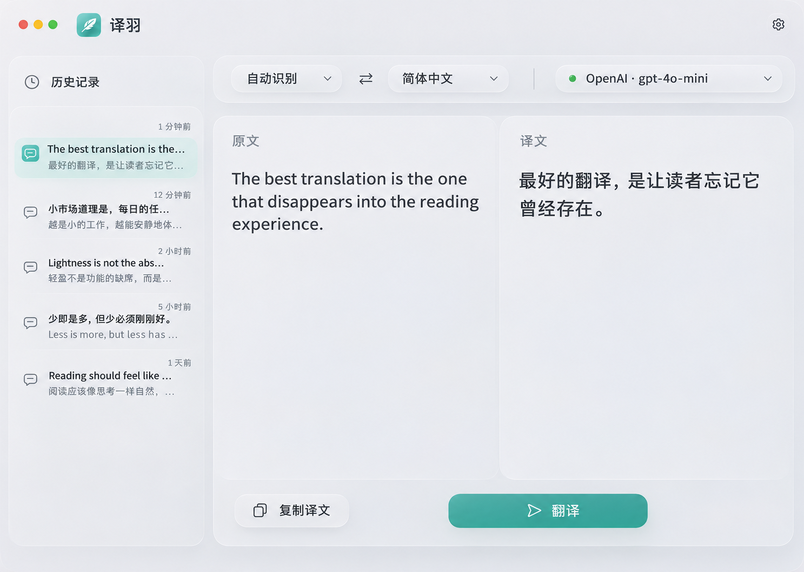
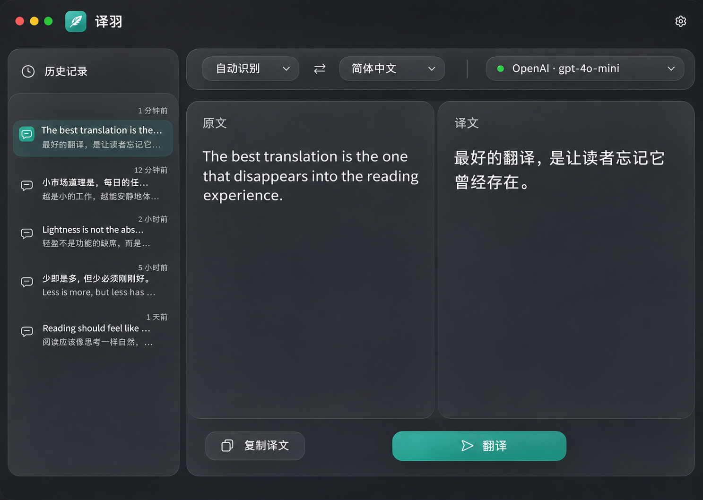
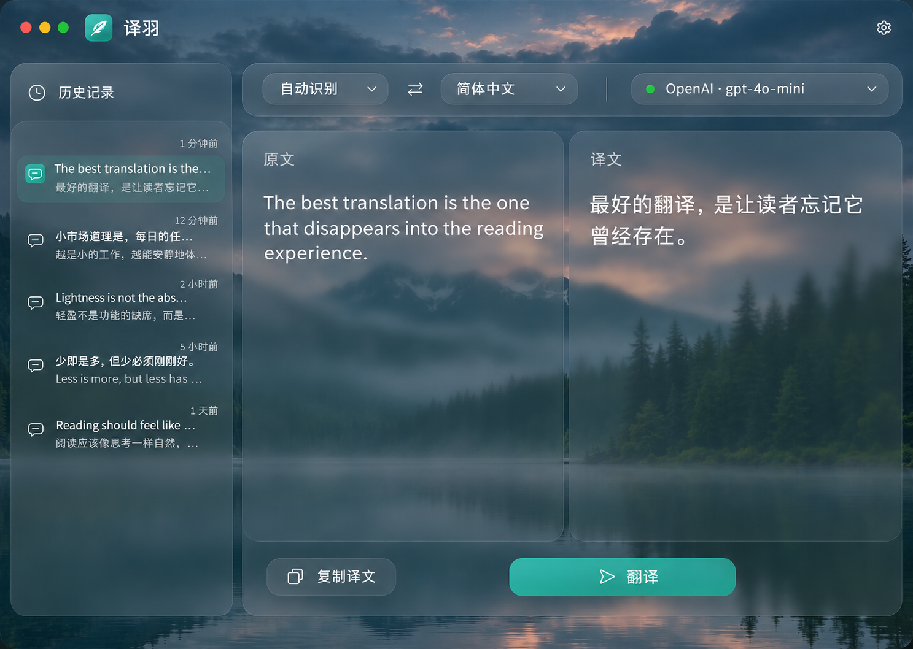

# 译羽前端整体重构规划

状态：已按用户确认的高斯磨砂玻璃方向实施主要界面和自定义背景。效果图用于表达视觉方向；平台验证进度见 `docs/qa/frontend-redesign.md`。

## 产品目标

译羽是一个随时可调用的桌面翻译工具。用户从其他应用划词后，应当能在快捷浮窗中迅速读到译文、复制并继续原来的工作；需要持续翻译或查找记录时，再打开主窗口。界面需要体现 Tauri 前端的精致感，同时保持阅读清晰、操作轻快和跨平台一致性。

本次重构覆盖主窗口、快捷浮窗、设置、首次配置、共享组件及其状态。继续使用现有 Rust core、Tauri shell、React、Zustand 与已定义的翻译契约；背景图片已接入本地设置与受控资源存储。

## 已明确的视觉方向

- 提供浅色、深色和跟随系统；浅色与深色使用同一套布局、组件和交互。
- 应用图标采用用户选定的“双羽”方案；桌面图标生成入口为 `assets/icon.svg`，界面品牌元素在后续重构中与该形象保持一致。
- 面板采用常规半透明高斯模糊玻璃。重点是图片或底层表面透过面板后的柔和模糊，而不是厚重的玻璃折射、发光描边或浮雕按钮。
- 保留适量强调色，用于主要操作、选中项和必要状态。文字、焦点、成功和失败不能只靠颜色区分。
- 用户可以选择自定义背景图片，也可以移除图片、回到干净的中性底色。示例风景只是用于验证效果，不是限定主题。
- 无背景图时使用安静的浅色或深色中性底色；不添加彩色光带、视频、复杂装饰图案或持续播放的背景动画。
- 可读性优先：图片再明显，也应保证原文、译文和控制项清楚可辨。

### 主窗口效果参考

浅色和深色基础方案：

带自定义背景图片的深色示例：

这些图是静态视觉稿。实际效果依赖浏览器及系统窗口合成，图中的控件尺寸、文字、透明度和背景裁切需要在真实应用中重新设计和验证。

### 其他窗口与状态覆盖

- [快捷浮窗参考](concepts/yiyu-popup-reference.png)：原文折叠、译文、复制及固定；浅色沿用相同结构和浅色语义色。
- [设置窗口参考](concepts/yiyu-settings-reference.png)：导航、主题与背景选择；表单错误、草稿和其余配置沿用现有可访问控件。
- [首次配置参考](concepts/yiyu-onboarding-reference.png)：选择服务、连接模型、系统权限三步；深色沿用相同结构和深色语义色。
- 各窗口及应用内对话框覆盖无背景、有背景、空状态、处理中和错误恢复；快捷浮窗也使用所选背景与同一套轻玻璃材质。概念图表达方向，产品功能与最终尺寸以现有契约为准。

| 窗口 | 默认尺寸 | 最小尺寸 |
| --- | --- | --- |
| 主窗口 | 980 × 660 | 760 × 500 |
| 设置 | 860 × 640 | 720 × 520 |
| 首次配置 | 780 × 640 | 700 × 560 |
| 浮窗 | 380 × 260 | 按内容与系统约束动态调整 |

## 参考材料的转化

用户提供的天气界面参考以低透明度叠色、约 18–26px 的背景模糊和较轻的圆角面板建立层次；Bloom 参考也使用透明表面和背景模糊。这里取它们的材质逻辑，不复刻天气、植物、星球、页面文案或宣传页布局。

模糊半径与透明度只作为初始调试范围。相同参数在不同图片、浅深主题和操作系统合成环境下效果不同，最终值以实际可读性、性能与视觉验收确定。背景完全均匀时，模糊本身不一定可见，应依靠适度的明度差和透明层次建立界面，而不是人为添加彩色装饰。

## 界面与交互

### 主窗口

- 顶部整合语言方向、交换语言和当前模型。历史侧栏提供搜索、新建、删除及相关反馈。
- 工作区优先保证原文输入和译文阅读。宽窗口并排显示；窗口变窄时允许工具栏换行、历史区折叠或以浮层展开，避免控件遮挡。
- 原文支持输入、粘贴和快捷键提交；译文支持流式显示、停止、复制、重试与错误恢复。长文本需要清晰的独立滚动和稳定的操作位置。
- 空状态给出简洁可执行的提示；载入、翻译中、完成、取消、失败、历史未保存等状态都有清楚反馈。

### 快捷浮窗

- 与主窗口共享相同材质、颜色语义和文字体系，但按较小窗口重新排版；译文是第一视觉重点。
- 保留原文折叠、流式译文、复制、重译、固定、关闭与失败恢复；权限错误提供设置入口。
- 有背景图时，面板增加适当遮罩以保证读字；需要结合真实桌面验证背景显示策略。无图或材质不可用时使用对应主题的中性表面。
- 非激活显示、原应用焦点、外部点击、Esc、固定、多显示器定位及输入行为必须按现有产品契约逐项验证，不能只依据浏览器截图判断。

### 设置与首次配置

- 设置保留模型、通用、网络、更新和关于等现有能力；重排导航和表单层级，将基础配置与自定义 Prompt、代理等高级选项分开呈现。
- 外观设置提供浅色、深色、跟随系统，以及本地背景图片的选择、预览、替换和移除。选图失败、图片不可读和移除后的恢复都要有明确反馈。
- 首次配置引导用户选择模型服务、填写凭据、测试连接和处理系统权限。高级字段不应遮挡首次使用主路径。
- 保留密钥系统凭据库存储、草稿保留、字段错误、连接测试与模型手动输入等既有行为；设计不能以简化视觉为由移除能力。

## 自定义背景图片

这是用户提出的新增功能，建议作为外观设置的一部分，与主题选择独立：

1. 从本地选择图片，先预览，再应用；支持替换和恢复无图片背景。
2. 图片按窗口尺寸裁切填充；窗口缩放、不同屏幕比例以及图片过亮或过暗时，使用适当的主题遮罩来维持文字对比。
3. 保持在本地使用。需要设计图片格式、尺寸限制、持久化位置和文件失效时的回退；不要把图片二进制或敏感内容写入普通配置与日志。
4. 重启后恢复用户选择；文件无法读取时自动回到主题底色，并在设置中给出可恢复的提示。
5. 快捷浮窗、设置窗口与其他窗口共用用户选择的背景，按各自窗口尺寸裁切；材质不可用时使用可读的主题底色。

## 窗口细节

- 应用内确认对话框和通知使用同一套轻玻璃表面，危险操作保留简洁明确的确认；关闭或取消不改变用户数据。
- 菜单栏沿用系统原生菜单，按翻译操作、窗口与应用操作分组，展示现有快捷键；快捷键变更后同步菜单。
- 文本输入焦点以光标为主；键盘操作的其他控件保留清晰、克制的焦点提示。选中状态以轻微明度变化表达。
- 清理重复提示、标语和次要标签，通过分组、对齐和间距表达层级；权限、失败和不可逆操作仍保留必要说明。

## 设计系统与实现边界

- **色彩与层次**：语义化定义主题底色、玻璃表面、分隔线、主次文字、强调、错误、焦点和遮罩；浅深主题分别调校，而非简单反色。
- **玻璃材质**：定义窗口表面、内容面板、轻量控件和浮层几个等级；控制透明度、模糊、边界与阴影，禁止到处叠加多层玻璃。
- **文字与控件**：以系统中英文字体为基础，常规界面文字约 13–15px，正文与译文按窗口空间提供更舒适的字号和行距；避免依赖 9–10px 灰字传达必要信息。
- **动效**：只在窗口出现、状态切换和必要反馈中使用短暂、平滑的动画；支持系统及应用的减弱动效设置，空闲时不运行装饰动画。
- **前端结构**：将主题变量、材质和动效从页面细节中提取；围绕按钮、输入、选择器、提示、浮层和状态反馈建立可复用组件。拆分过大的窗口组件，同时保持 `web/src/lib/contract.ts`、后端命令及事件的边界清晰。
- **新增依赖**：优先使用现有 React、Tailwind、Motion 与图标；是否引入额外组件或平台材料依赖，应由实际交互和可维护性验证决定。
- **系统合成**：先在 macOS 和 Windows 上验证 Tauri 窗口透明、背景图片、WebView 模糊及非激活浮窗的组合；不预设 CSS 模糊一定能处理窗口外的桌面内容。不可用时使用可读的半透明或不透明回退。

## 与当前 OpenSpec 的关系

原有 `add-yiyu-desktop-translator` change 的部分视觉要求已与新方向协调；旧变更的完成记录和非视觉行为保持原状。新外观及背景行为记录在 `redesign-yiyu-frontend` change 中，既有翻译、历史、凭据、代理、更新和真机验收要求继续有效。

## 设计验证和实施顺序

先确认主窗口的浅色、深色及带背景状态，并补齐浮窗、设置和首次配置的同体系设计；再验证真实系统上的模糊与窗口行为，建立共享材质与组件，逐个迁移窗口。背景设置涉及本地文件和配置，需与 Tauri 层一起设计，不能只在浏览器 mock 中实现。

验收至少包括：

- 主窗口默认尺寸 `980 × 660` 和最小尺寸 `760 × 500`，设置窗口及首次配置的默认和最小尺寸，以及快捷浮窗的内容变化与边界定位。
- 浅色、深色、跟随系统、有图、无图、过亮图、过暗图、图片失效，以及中英文和长文本。
- 空、加载、流式、完成、取消、错误、无模型、复制、历史和设置保存失败等状态。
- 键盘导航、可见焦点、减弱动效与文字/控件对比；常规正文以至少 4.5:1、必要控件以至少 3:1 作为检查目标，具体以实际渲染测量为准。
- 浏览器 mock 截图用于设计回归，另加控件不遮挡等行为断言；macOS/Windows 真机验证取词、焦点、图片渲染、性能和系统窗口效果。
- 背景图片和玻璃效果不得引入持续的视频播放或空闲轮询；首屏资源与空闲占用应相对当前基线复测。

本规划不代表真实模型、系统取词、安装、更新和跨平台后台驻留已完成端到端验收。这些仍按现有 Beads 和 QA 记录执行。
